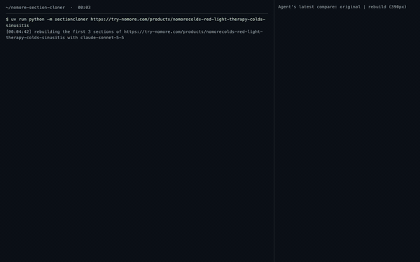

# nomore-section-cloner

[](https://github.com/jeromejhipolito/nomore-section-cloner/releases/download/v0.1.0/demo.mp4)

**▶ [Watch the full run (4 min 14 s, real time, mp4)](https://github.com/jeromejhipolito/nomore-section-cloner/releases/download/v0.1.0/demo.mp4)**: the real
`python -m sectioncloner <url>` process from start to finish, with each side-by-side compare the agent looks at as
it appears, ending on the rebuilt page at phone size. The GIF above is a short preview of that recording.

A [Claude Agent SDK](https://github.com/anthropics/claude-agent-sdk-python) script that takes a Shopify product
page URL and rebuilds the page's **first 3 sections** as **one Liquid section** in your Shopify theme, as close to
the original as possible **on mobile**. Every text and every image ends up as a theme-editor setting, so nothing
is hardcoded.

```bash
make install
cp .env.example .env        # fill in the 4 values (see Setup)
make run                    # = uv run python -m sectioncloner <url>
```

## What it does

```
source URL ──► scrape (Playwright, 390px iPhone viewport)
                 compact DOM digest: tags, sizes, computed styles, text, image URLs  (~11k tokens)
                 + screenshot tiles of the first 3 sections
           ──► Claude agent (claude-sonnet-5-5, 5 tools, nothing else)
                 get_source → write_files → compare → (edit_file → compare)* → finish
           ──► your store
                 sections/nomore-landing.liquid          one section: markup +  + 
                 templates/product.nomore.json           the scraped copy + CDN image URLs as setting values
                 product "nomore-landing-placeholder"    one variant, dummy price, uses the template above
```

| Tool | What it does | Guard |
|---|---|---|
| `get_source` | scrapes the source once; returns the digest + screenshots | 2 calls |
| `write_files` | lints, uploads both files to the live theme, reads them back, creates the placeholder product | 4 calls |
| `edit_file` | exact one-match replace in the last written file, then the same lint/upload/read-back | 25 calls |
| `compare` | screenshots the rebuilt section on the storefront; returns original \| rebuild side by side per band | **4 calls = the visual iteration cap** |
| `finish` | accepted only if the latest change was written **and** compared | 3 calls |

The limits live in Python (`agent.py`), not in the prompt. Every successful compare snapshots the files it checked.
However the session ends (an accepted `finish`, the $4.50 cap, the turn cap, an SDK error), the store is closed to
further writes and checked against that last compared version; if it differs, that version is uploaded in one call
and read back. If Shopify never confirmed an earlier write, the restore is always done and re-checked after 20s.
(Before the first successful compare there is no such version to return to. A write Shopify had accepted but not yet
applied when the process exits can still land afterwards; no client can prevent that.) Crashed calls
caused by infrastructure (network, Shopify 5xx/throttling, a browser that died) don't use up a tool's attempts, up to 3.

| Exit code | Meaning |
|---|---|
| `0` | done: `finish` accepted, and the store holds exactly the last written, read-back **and** compared version |
| `1` | no compared version exists (even if `finish` was accepted), or the session ended without an accepted `finish` (putting the last compared version back is still attempted; the log says if it worked) |
| `2` | usage/config error before the agent started (bad URL, missing `.env` key, token scopes) |
| `3` | `finish` accepted, but the store could not be put back on the last compared version (the log says why) |
| `4` | Shopify was unreachable or erroring before the agent started: nothing is misconfigured, retry |

Once the agent has started, the run's final status line includes its **API cost** (`ResultMessage.total_cost_usd`), even
when it fails; it reads `unknown` only if the SDK never reported a result. Exit `2` stops before the agent starts, so it
costs nothing; a temporary Shopify outage at that point exits `4` instead, so a script can retry it.

### "No hardcoded content" is enforced, not requested

`lint.py` rejects a write when the section's markup contains any literal text, any literal image/link URL, or any
literal `alt`/`title`/`aria-label`. CSS, JS, inline SVG icons and the `` block are excluded. The agent
gets the exact list of violations back and has to fix them before anything reaches the store.

Images use a `url` setting (the source CDN link, used as-is) plus an optional `image_picker` override, because
Shopify's image picker can't hold an external URL. Swap any image in the theme editor by picking a file.

After each write, the agent also gets a **content-gap** list: source texts and image URLs that aren't in the
written files yet.

## Setup

1. **Dev store.** A free Partner development store works: <https://partners.shopify.com> → Stores → Add store.
2. **Admin API token.** In the store admin: Settings → Apps → Develop apps → create a (legacy) custom app →
   Admin API scopes: `read_products write_products read_themes write_themes read_publications write_publications`
   → Install → copy the `shpat_…` token.
3. **Storefront password.** Dev stores are always password-protected. The agent needs the password from
   Online Store → Preferences to screenshot its own work.
4. **Claude.** Set `ANTHROPIC_API_KEY`, or leave it empty to use a logged-in `claude` CLI.
5. Fill `.env`:

| Key | Value |
|---|---|
| `SHOPIFY_STORE_DOMAIN` | `your-store.myshopify.com` |
| `SHOPIFY_ADMIN_TOKEN` | `shpat_…` |
| `STOREFRONT_PASSWORD` | the storefront password |
| `ANTHROPIC_API_KEY` | optional |

Requirements: Python 3.11+, [uv](https://docs.astral.sh/uv/), Node 18+ (the Agent SDK drives the Claude Code CLI).

## Run

```bash
make run
# or another page / section count / model:
uv run python -m sectioncloner https://example.com/products/x --sections 3 --model claude-sonnet-5-5
```

Each run writes `runs/<timestamp>/`: `run.log`, the source tiles, every rebuild screenshot and every side-by-side
comparison the agent saw.

The rebuilt page is at `https://<store>/products/nomore-landing-placeholder`. To edit it, open
Online Store → Themes → Customize → Products → `nomore`.

## Cost

One full run: see **Live run** below. The digest is pruned (hidden nodes skipped, wrapper divs collapsed, only
styles that differ from the parent), the screenshots are phone-width tiles, and small fixes go through `edit_file`
instead of rewriting the file. That keeps a run well under $5.

## Tests

```bash
make test        # offline: the hardcoded-content linter, template shape, content-gap check
```

## Live run

The recorded run (`runs/20261023-000442`, dev store `jerome-cloner-demo`, theme Horizon):

| | |
|---|---|
| Command | `uv run python -m sectioncloner https://try-nomore.com/products/nomorecolds-red-light-therapy-colds-sinusitis` |
| Model | `claude-sonnet-5-5` |
| Wall time | 3 min 23 s (scrape → write → 4 compares → finish) |
| Turns | 12 |
| Compares used | 4 of 4 |
| Height, original vs rebuild (390px wide) | 2714px vs 2690px (−0.9%, inside the 1.5% gate) |
| **API cost** | **$2.79** (`ResultMessage.total_cost_usd`). Other full runs: $3.10, $2.86, $2.66. Hard cap: $4.50 |
| Exit code | 0 (finish accepted after a current write + compare) |
| Hardcoded content in the deployed section | 0 (`lint.py` on the file read back from the store) |
| Editable in the theme editor | every text and image is a section or block setting; images use the source CDN URLs; fonts are `font_picker` settings |

Checked by hand in the theme editor: changing a text setting and picking a new image both updated the live page.

### How the video was recorded

```bash
make record      # = uv run python scripts/record_run.py <url> -o demo.mp4
```

`scripts/record_run.py` starts the real run and streams its output, live, into a small local page next to the
latest compare image. Headless Playwright films that page, then films the rebuilt page at phone size, and ffmpeg
joins the two clips. Nothing is replayed or sped up, and no screen capture is involved.
